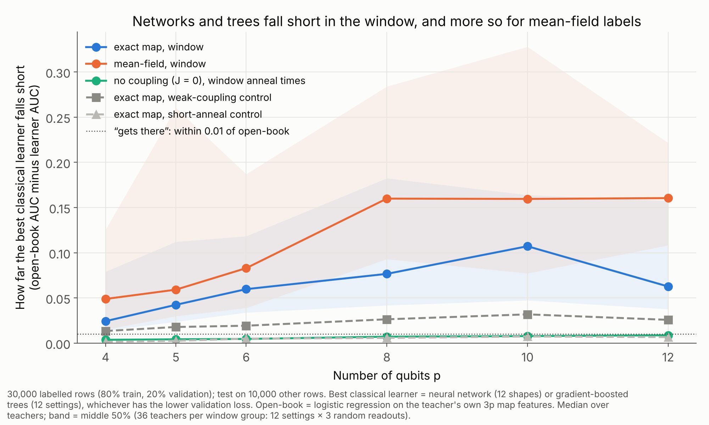
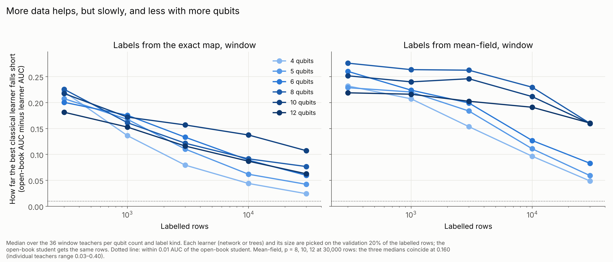
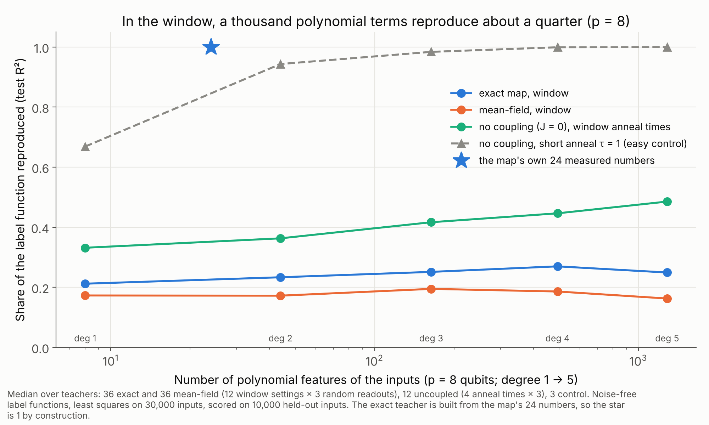
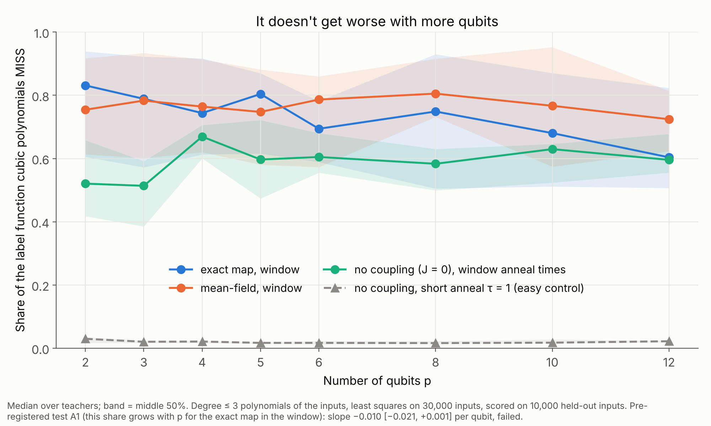

# S1 results: what does it take for a classical model to match the map?

*Part A run 2026-10-27/28 and Part B run 2026-10-28/29, both on ophlappc06 (2 L40S GPUs + CPU).
Plans and predictions: `PLAN.md` (Part A fixed in commit 045d6e7; Part B in Amendment 1, §9,
fixed before any Part B learner ran). Logs: `runs/s1_partA.log`, `runs/s1_partB.log`. Tables:
`runs/studies/s1/S1_PARTA.csv`, `S1_PARTB.csv`. Figures are made from those tables by
`figures.py` (Part A) and `figures_partB.py` (Part B).*

## Part B in plain language: can flexible classical learners get there?

**What we asked.** Part A showed polynomials can't copy the map's labels in the window. But
polynomials are a weak opponent. So we tried the strongest generic classical learners we have:
neural networks [1, 2] (12 shapes, up to 3 million parameters) and gradient-boosted trees
[3, 4, 5] (12 settings), from 300 to 30,000 labelled examples, at 4 to 12 qubits. Each learner picked its own
size on held-out validation rows, as a practitioner would. The yardstick is the "open-book"
student, a simple linear model on the map's own outputs.

**What we found.**

- **Even the flexible learners don't get there in the window.** They beat the fixed bases
  (polynomials, Fourier, random Fourier features [6]) clearly, but rarely match the open-book
  student. With exact-map labels, they get within 0.01 AUC on 14% of teachers at 4 qubits, and
  on none at 10–12 qubits. On the easy short-anneal control, they get there every time.
- **It gets somewhat harder with more qubits.** For exact-map labels the median gap grows from
  0.02 AUC at 4 qubits to 0.06–0.11 at 8–12.

- **The difficulty is not quantum.** The mean-field labels are *harder* for classical learners,
  and get harder faster: their gap grows from 0.05 to 0.16. We had predicted the two would grow
  about equally; the difference points away from a quantum effect, not toward one. So what makes
  these labels hard to learn belongs to the Ising-type anneal, which mean-field shares.
- **More data helps, but slowly, and less at more qubits.** At 4 qubits the exact-label gap
  roughly halves with each 3× more data. At 8–12 qubits it shrinks much more slowly. We can't rule
  out that far more data (hundreds of thousands of examples) would close it for small systems.

- **The anneal time drives it, as in Part A.** At 8 qubits the exact-label gap is 0.04 at
  τ = 3 and 0.20 at τ = 20.
- **A sign the classical opponents aren't simply broken:** labels from uncoupled qubits (J = 0),
  which are a sum of separate one-qubit pieces, are learned almost perfectly by the Fourier
  basis that adds up one-input sine waves (gap 0.001–0.003).

**What it means.** Two separate facts:
1. **The window's labels are hard for generic classical learners,** and somewhat harder as
   qubits are added. That comes from the anneal dynamics, and mean-field labels have it too.
2. **The quantum part is what mean-field can't copy** (S2).

So the quantum claim rests on S2's exact-versus-mean-field gap, not on "classical learners fail".

The two results answer different questions. That's why some of our findings sound "quantum"
and others don't:

| Question | Answer in the window | Quantum? |
|---|---|---|
| **A. Can a generic classical learner learn these labels from examples?** (S1 Parts A and B) | No, for exact-map *and* mean-field labels; mean-field's are harder | **No.** Mean-field shares it. |
| **B. Can mean-field reproduce what the exact map does?** (S2) | No: it misses about 80%, up to 16 qubits | **Yes.** Only the quantum correlations differ. |

The quantum part makes the exact map's labels *different* from mean-field's, not *harder to learn*.

**What to be careful about.**
- **Networks might be undertrained on the hardest labels.** At 10–12 qubits validation often
  picks the *smallest* network for mean-field labels. On some teachers every learner, trees and
  fixed bases included, stays below AUC 0.6. That looks like genuinely hard labels, not one
  optimizer failing, but each network got one learning rate and early stopping with limited
  patience. A robustness check with 10× longer training and two learning rates (PLAN.md §10,
  Amendment 2, written after these results) is designed to settle it.
- **30,000 examples is the most we tried.** The gap is still shrinking there.
- **One family of opponents.** Generic learners that don't know the physics. A learner given
  mean-field's outputs as features is S2's question, not this one.

### References

1. Paszke, A. et al. (2019). PyTorch: an imperative style, high-performance deep learning library. *Advances in Neural Information Processing Systems* 32 (NeurIPS 2019).
2. Kingma, D. P. & Ba, J. (2015). Adam: a method for stochastic optimization. *ICLR 2015*. [arXiv:1412.6980](https://arxiv.org/abs/1412.6980)
3. Friedman, J. H. (2001). Greedy function approximation: a gradient boosting machine. *Annals of Statistics* 29(5), 1189–1232.
4. Ke, G. et al. (2017). LightGBM: a highly efficient gradient boosting decision tree. *Advances in Neural Information Processing Systems* 30 (NeurIPS 2017). (The histogram method behind scikit-learn's HistGradientBoosting.)
5. Pedregosa, F. et al. (2011). Scikit-learn: machine learning in Python. *Journal of Machine Learning Research* 12, 2825–2830.
6. Rahimi, A. & Recht, B. (2007). Random features for large-scale kernel machines. *Advances in Neural Information Processing Systems* 20 (NeurIPS 2007).

*[1]–[5] are the tools used; [6] is the random-feature method. The finding itself (generic learners
fall short, more so for mean-field labels) has no prior reference: it's ours.*

## Part A in plain language: how complicated are the labels?

**What we asked.** In the window, simple classical models can't copy the quantum feature map.
One possible reason is that the map's labels are complicated functions of the inputs. We
measured how complicated, and whether that gets worse as we add qubits.

**How.** For 2 to 12 qubits, we ran the map on 40,000 random inputs and built label functions
("teachers") from its outputs. We then tried to reproduce each one with polynomials of the
inputs: first straight lines, then squares and pairwise products, then cubes, and so on up to
about 1,300 terms. We compared four kinds of teacher:
- the exact quantum map in the window;
- its cheap mean-field approximation;
- an uncoupled version (J = 0), where each output depends on one input only;
- an easy control with a short anneal.

**What we found.**

- **Outside the window, polynomials work.** For the short-anneal control, degree-2 polynomials
  (44 terms at 8 qubits) reproduce 94% of the label function, and degree 3 gets 98%.
- **In the window, they don't.** At 8 qubits, even 1,300 polynomial terms reproduce only about a
  quarter of the exact map's label function. The map's own 24 measured numbers reproduce all of
  it.

- **It doesn't get worse with more qubits.** The share polynomials miss stays between about 0.6
  and 0.8 from 2 qubits to 12. We had predicted it would grow; it didn't.

- **The quantum part isn't the cause.** Mean-field labels are at least as hard for polynomials,
  and uncoupled qubits are nearly as hard. What makes the difference is the **long anneal**: it
  makes each qubit's output swing back and forth rapidly as its input changes, and polynomials
  are bad at following that.

**What it means.** The difficulty polynomials have in the window is real and large, but it's set
by the anneal time, not by the number of qubits, and it isn't specifically quantum. The quantum
part shows up elsewhere: S2 found that mean-field can't reproduce the exact map in the window at
any size up to 16 qubits. The next question is whether classical models built for oscillating
functions (Fourier features, neural networks) also struggle, and whether *that* grows with
qubits. That's Part B, above. Polynomial degree turned out to be the wrong yardstick for these
functions.

**One caveat.** At very high polynomial degree with few qubits, the fitting became numerically
unreliable. That affects only one side table, not the results above, and it will be fixed
before that table is used.

---

## Details, Part B

### Checks (pre-registered in PLAN.md §9; tested at n = 30,000)

| | Prediction | Result | |
|---|---|---|---|
| B0 | Sanity: the learned group gets there in the short-anneal control (c = 4, τ = 1), exact teachers, every p | largest shortfall 0.007 | **held** |
| B1 | Fixed bases short by > 0.01 in ≥ 9 of 12 window cells (exact), every p | 12, 12, 12, 11, 12, 11 of 12 (p = 4 … 12) | **held** |
| B2 | p = 8: learned smaller shortfall than fixed in ≥ 9 of 12 window cells, **and** gets there in ≤ 5 | better in 10 of 12; gets there in 1 of 12 | **held** |
| B3a | Growth: median slope of the learned shortfall against p, exact, window, > 0 | +0.0045 [+0.0025, +0.0068] per qubit | **held** |
| B3b | Not quantum-specific: exact minus mean-field slope, interval contains 0 | −0.0101 [−0.0151, −0.0029] | **failed**: mean-field labels get harder faster |

Definitions:
- **Shortfall** = open-book test AUC − learner test AUC at the same n.
- **Learned** = best of networks and trees; **fixed** = best of Hermite polynomials, Fourier and
  random Fourier features. "Best" means the lowest validation loss, never the test.
- **Open-book** = L2 logistic regression on the teacher's own 3p map features, same rows, same
  rules. Its median test AUC in the window at n = 30,000 is 0.946–0.948.

### Median shortfall at n = 30,000

| group | p = 4 | 5 | 6 | 8 | 10 | 12 |
|---|---|---|---|---|---|---|
| exact, window: learned | 0.024 | 0.042 | 0.060 | 0.077 | 0.107 | 0.063 |
| exact, window: fixed | 0.132 | 0.130 | 0.121 | 0.104 | 0.144 | 0.077 |
| mean-field, window: learned | 0.049 | 0.059 | 0.083 | 0.160 | 0.160 | 0.160 |
| mean-field, window: fixed | 0.167 | 0.198 | 0.205 | 0.252 | 0.239 | 0.195 |
| J = 0, window anneal times: learned | 0.004 | 0.004 | 0.005 | 0.007 | 0.008 | 0.009 |
| J = 0, window anneal times: fixed | 0.001 | 0.001 | 0.001 | 0.002 | 0.002 | 0.003 |
| exact, weak-coupling control: learned | 0.013 | 0.018 | 0.019 | 0.026 | 0.032 | 0.026 |
| exact, short-anneal control: learned | 0.001 | 0.003 | 0.005 | 0.006 | 0.007 | 0.007 |

- **The mean-field 0.160 at p = 8, 10, 12 is a coincidence of medians.** The individual teachers
  range from 0.03 to 0.40, with quartiles [0.09, 0.28], [0.08, 0.33] and [0.11, 0.22].
- **By family** (exact, window): networks alone 0.024–0.156; trees alone 0.027–0.107. Trees
  are the validation choice for 163 of 216 exact-window teachers; networks for 206 of 216
  mean-field-window teachers.
- **J = 0:** the axis-by-axis Fourier basis matches J = 0 labels almost exactly (they are sums of
  one-input functions). Polynomials (0.09–0.18) and random Fourier features (0.10–0.17) don't.
- **The weak-coupling control is not easy** (0.013–0.032; no teacher gets there at any n), even
  though mean-field is nearly exact there (S2). Another case of "hard for classical learners"
  without any quantum part.

### By anneal time (learned, median shortfall, n = 30,000)

| | τ = 3 | 5 | 10 | 20 |
|---|---|---|---|---|
| exact, p = 4 | 0.008 | 0.019 | 0.066 | 0.196 |
| exact, p = 8 | 0.036 | 0.049 | 0.156 | 0.203 |
| exact, p = 12 | 0.036 | 0.053 | 0.113 | 0.171 |
| mean-field, p = 4 | 0.012 | 0.030 | 0.125 | 0.140 |
| mean-field, p = 8 | 0.057 | 0.161 | 0.268 | 0.257 |
| mean-field, p = 12 | 0.103 | 0.198 | 0.185 | 0.189 |

### By number of labelled rows (learned, exact, window, median shortfall)

| n | p = 4 | 5 | 6 | 8 | 10 | 12 |
|---|---|---|---|---|---|---|
| 300 | 0.221 | 0.208 | 0.200 | 0.226 | 0.217 | 0.181 |
| 1,000 | 0.136 | 0.168 | 0.176 | 0.161 | 0.172 | 0.153 |
| 3,000 | 0.079 | 0.110 | 0.133 | 0.122 | 0.157 | 0.116 |
| 10,000 | 0.044 | 0.062 | 0.089 | 0.091 | 0.137 | 0.087 |
| 30,000 | 0.024 | 0.042 | 0.060 | 0.077 | 0.107 | 0.063 |

**B4 (reported): share of teachers that get there at some n ≤ 30,000.**
- exact, window: 0.14, 0.06, 0.03, 0.08, 0, 0 (p = 4 … 12);
- mean-field, window: 0.11 at p = 4, then 0;
- short-anneal control and J = 0 teachers: essentially all get there, typically by n = 3,000–30,000;
- weak-coupling control: none.

### Training health

- **Share of window teachers where the chosen learner scores below AUC 0.6**: exact 0–3%;
  mean-field 0–25% (largest at p = 10). The same teachers are near chance for fixed bases and
  trees too.
- **Chosen network width** (median): exact 256 at p ≤ 8, 64 at p = 10–12; mean-field 256 at
  p ≤ 6, then 160, 40, 16.
- **No job failed.** Run time: 1 h 57 min on 2 GPUs (179 jobs) and 38 min for the trees on 29
  workers (270 jobs).

---

## Details, Part A

### Checks (pre-registered; the test is at degree 3, degree 4 is reported)

A slope is the change per qubit in V_d, the share of the label function that polynomials of
degree ≤ d miss, fitted over p = 4–12. Each group's number is the median over its teachers;
the 95% intervals come from a bootstrap over teachers.

| | Prediction | Degree 3 | Degree 4 | |
|---|---|---|---|---|
| A1 | Exact, window: V_d grows with p (slope > 0) | −0.0097 [−0.0206, +0.0014] | −0.0047 [−0.0174, +0.0072] | **failed** |
| A2 | …faster than the exact control cells | −0.0051 [−0.0164, +0.0103] | −0.0025 [−0.0152, +0.0105] | failed |
| A2 | …faster than J = 0 at the window's anneal times | −0.0066 [−0.0247, +0.0146] | −0.0027 [−0.0239, +0.0161] | failed |
| A3 | Exact minus mean-field slope has an interval containing 0 | −0.0070 [−0.0217, +0.0092] | −0.0052 [−0.0232, +0.0095] | held, trivially (neither grows) |

**Outcome (F)** in the plan's terms: in polynomial degree, the label functions don't get more
complex with p.

### V₃ by group and p (median)

| | p = 2 | 3 | 4 | 5 | 6 | 8 | 10 | 12 |
|---|---|---|---|---|---|---|---|---|
| exact, window | 0.83 | 0.79 | 0.74 | 0.80 | 0.69 | 0.75 | 0.68 | 0.60 |
| mean-field, window | 0.75 | 0.78 | 0.76 | 0.75 | 0.79 | 0.81 | 0.77 | 0.72 |
| J = 0, window anneal times | 0.52 | 0.51 | 0.67 | 0.60 | 0.60 | 0.58 | 0.63 | 0.60 |
| exact, control cells | 0.09 | 0.17 | 0.28 | 0.28 | 0.26 | 0.25 | 0.35 | 0.20 |
| J = 0, short anneal (τ = 1) | 0.03 | 0.02 | 0.02 | 0.02 | 0.02 | 0.02 | 0.02 | 0.02 |

**Groups:**
- exact, window and mean-field, window: 36 teachers each (12 settings × 3 readouts);
- J = 0, window anneal times: 12 teachers (4 anneal times × 3 readouts);
- exact, control cells: 6 teachers (2 cells × 3 readouts);
- J = 0, short anneal: 3 teachers.

### At p = 8: share reproduced (test R²) against the number of polynomial terms

| terms (degree) | 8 (1) | 44 (2) | 164 (3) | 494 (4) | 1,286 (5) |
|---|---|---|---|---|---|
| exact, window | 0.21 | 0.23 | 0.25 | 0.27 | 0.25 |
| mean-field, window | 0.17 | 0.17 | 0.20 | 0.19 | 0.16 |
| J = 0, window anneal times | 0.33 | 0.36 | 0.42 | 0.45 | 0.49 |
| J = 0, short anneal | 0.67 | 0.94 | 0.98 | 1.00 | 1.00 |

**Why some curves dip.** The small dips at 4–5 are the expected out-of-sample cost of adding
terms that capture nothing new. A fit with m terms on 30,000 rows inflates the missed share by
about 1/(1 − m/30,000), which is 4% at 1,286 terms.

### Known problem: high-degree fits at small p

For p ≤ 5 at degree 8 and above, V_d *rises* with degree, up to impossible values (V > 1). With
45–1,800 terms on 30,000 rows that can't be overfitting. It's the solver: it squares the
condition number of the high-degree Hermite design.

**What it affects.** The "degree needed for R² ≥ 0.90 / 0.99" tables in the log, at p ≤ 5. Do not
quote those.

**What it doesn't affect.** Anything at degree ≤ 5: every V there is ≤ about 1.0, with no
blow-ups. That includes the degree-3 test, the degree-4 robustness check, and both figures.

**The fix,** for a later amendment: solve by QR on the design, not the normal equations.

### Interpretation, and what's next

The "long anneal → oscillation" reading comes from the J = 0 contrast. Uncoupled qubits are
easy for polynomials at τ = 1 (V₃ = 0.02) and hard at τ = 3–20 (0.5–0.67), at every p. It's an
interpretation, not a separate test.

**Proposed next measurement** (an amendment, post hoc): **interaction order** instead of
degree. How much of each label function is a sum of one-input functions, however wiggly? How
much needs pairs of inputs, and how much more than pairs? That's the part that could grow with
p, and the part the coupling should affect. *(Parked, 2026-10-28: Part B was run first, with its predictions fixed in PLAN.md §9.)*
