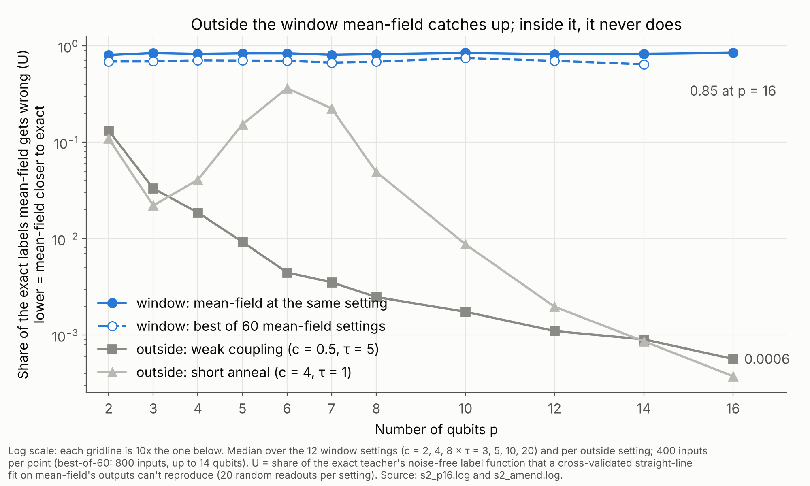
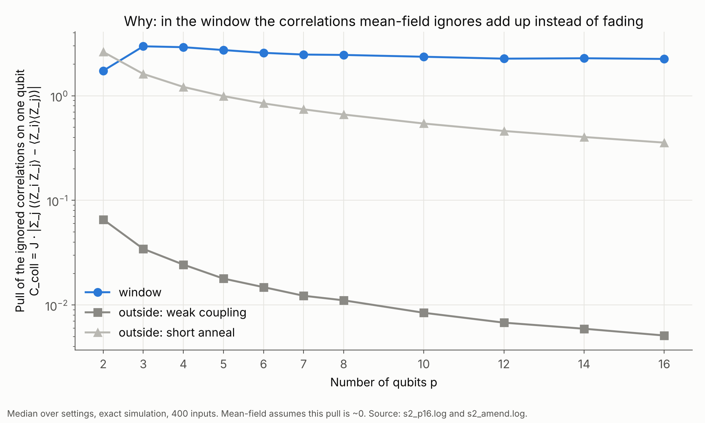

# S2 results: mean-field does not catch up in the window (p = 2–16)

*Runs of 2026-10-27 on the server. The plan, with predictions M1–M5 fixed in commit 6bb5cf7, is
in `PLAN.md`. Amendment 1 (A1, A2) was added after the primary results. Logs: `runs/s2.log`
(primary) and `runs/s2_amend.log` (amendment). Tables are in `runs/studies/s2/`. p = 16
(block 0, 400 rows) was added afterwards (`runs/s2_p16.log`, Section 6). The p = 2–14 tables
are kept as `*_p2-14.csv`.*

## In plain language

**What we asked.** Our quantum map couples every qubit to every other. With that kind of
coupling, physics says a cheap classical approximation, mean-field (each qubit feels only the
average of the others), should become exact as qubits are added. If it did, the window where the
quantum map can't be copied would just be a small-system effect.

**How.** For 2 to 16 qubits, we ran the exact map and mean-field on the same inputs and measured
how much of the exact map's label function mean-field's outputs can't reproduce. In the figure,
lower means mean-field is closer to exact.

**What we found.**

- **Outside the window, mean-field catches up, as physics predicts.** The share it misses falls
  from about 10% with 2 qubits to under 0.1% with 16.
- **Inside the window, it never does.** It misses about 80% at every size from 2 to 16 qubits, and
  still 64–75% when it's allowed to pick its best settings. That's not what we predicted; we
  expected slow convergence.

- **The reason:** the correlations mean-field ignores all lean the same way, so their combined pull
  on each qubit stays large however many qubits there are. Outside the window, the same pull fades
  away.

**What it means.** The window isn't a small-system artifact, at least up to 16 qubits, the largest
we can simulate. Inside it, the exact map does something its cheap classical twin can't, at every
size we tested. That's the strongest "quantum part" evidence in the project so far. It isn't yet
evidence that a quantum *computer* is needed: up to 16 qubits we simulate it classically.
- **Neural networks and boosted trees** trained on the inputs (S1 Part B) can't learn these labels
  either. But they can't learn mean-field's labels either, so that difficulty isn't quantum.
- **This study answers a different question:** whether the classical twin can reproduce the
  exact map. That's where the quantum part shows up.
- **Still to test:** a stronger classical twin than mean-field (pair corrections).

*Figures: `figures.py`, from `S2_MEASURES.csv` / `S2_AMEND.csv` (or the median tables in
`runs/s2_p16.log` and `runs/s2_amend.log`, which is what these were made from).*

### References

**None yet for this study's physics claims.** Two statements here rest on standard reasoning,
not on a cited source, and need references before any write-up:
1. "With all-to-all coupling J = c/(p−1), mean-field becomes exact as p grows."
2. "Mean-field's accuracy time near an unstable trajectory may grow only like log p"
   (Details, Section 4).

The stronger classical twin that follows from this study (S5, DTWA) is referenced in
`studies/s5_twin/PLAN.md`.

---

## Details

### In one paragraph (technical)

With our coupling (every qubit coupled to every other, J = c/(p−1)), theory says mean-field
should become exact as the number of qubits grows. It does, **outside the window**: in both
control cells, the share of the exact map's labels that mean-field can't explain falls from
a few percent to under 0.1% by p = 14. **Inside the window it doesn't fall at all.**
- With mean-field at the same coupling and anneal time, about 80% of the exact labels stay
  unexplained at every p from 2 to 16.
- With mean-field allowed to pick the best of 60 settings, about 65–75% stay unexplained, with
  no trend.

The correlations mean-field ignores get smaller pair by pair, but they share a sign. So
their total pull on each qubit stays the same size as p grows. We predicted the opposite
(slow convergence, but convergence), so **the window is not a small-system effect over
p = 2–16**.

### 1. Checks

| | Prediction | Result | |
|---|---|---|---|
| M1 | Controls: readout error E falls with p in both control cells | weak coupling α = 1.08 [1.03, 1.12]; short anneal α = 0.45 [0.45, 0.45] | **held** |
| M2 | Window: E falls with p in ≥ 9 of 12 cells | 5 of 12 | **failed** |
| M3 | Slower in the window than in the controls (median α difference < 0) | −0.77 [−0.80, −0.74] | held, trivially (it barely falls in the window) |
| M4 | Window: U falls with p (median α > 0) | −0.088 [−0.100, −0.040] | **failed** |
| M4 under A2 | Same, U on 800 rows | −0.060 [−0.066, −0.024] | failed |
| M4 under A1 | Same, U against the best of 60 mean-field settings, 800 rows | −0.067 [−0.080, −0.039] | failed |

The quantities:
- **E:** the RMS distance between exact and mean-field Bloch vectors.
- **U:** 1 − R² of the exact teacher's noise-free score, fitted on mean-field features with
  5-fold cross-validation, median over 20 random readouts. U = 0.8 means mean-field features
  explain 20% of what the exact labels contain.
- **α:** the exponent in measure ∝ p^(−α), fitted on p = 4–14, with a 95% interval from a
  bootstrap over rows. **Positive α = mean-field catching up.**

### 2. Labels: what mean-field can't explain (U, median over cells)

| p | window, matched setting (400 rows) | window, matched (800 rows) | window, **best of 60 settings** (800 rows) | weak-coupling control, matched (800) | short-anneal control, matched (800) |
|---|---|---|---|---|---|
| 2 | 0.80 | 0.80 | 0.69 | 0.13 | 0.10 |
| 4 | 0.83 | 0.81 | 0.71 | 0.018 | 0.038 |
| 6 | 0.84 | 0.81 | 0.70 | 0.004 | 0.33 |
| 8 | 0.82 | 0.76 | 0.69 | 0.002 | 0.049 |
| 10 | 0.85 | 0.80 | 0.75 | 0.002 | 0.007 |
| 12 | 0.82 | 0.75 | 0.70 | 0.001 | 0.002 |
| 14 | 0.83 | 0.79 | 0.64 | 0.0008 | 0.0007 |

- **Neither amendment changes the picture.**
  - A2 (800 rows) lowers U by a few points, as expected from the smaller finite-sample bias.
  - A1 (best setting) lowers it by about 0.1.
  - Neither produces a downward trend.
- **The short-anneal control bumps up at p = 5–7** before converging. We don't have an
  explanation; it's reported, not interpreted.
- **If the fitted trends continued** (M5, an extrapolation): U would fall below 0.01 at
  p ≈ 5 in the weak-coupling control and p ≈ 10 in the short-anneal control, which matches
  what we observe. In the window, it would take p ~10¹² or more, or never (α ≤ 0).

**Which mean-field setting fits best (A1) is informative.** In 7 of 12 window cells, the best
mean-field student at p = 14 is one with **much weaker coupling** (c = 0.5 or 1, versus the
teacher's 2–8). Strongly coupled mean-field is qualitatively wrong in the window. A weakly
coupled one, closer to independent qubits, is less wrong, but still leaves 33–91% unexplained.

### 3. Readout and correlations

| median over cells | p = 4 | p = 8 | p = 14 |
|---|---|---|---|
| window: readout error E | 0.78 | 0.81 | 0.80 |
| window: typical pair correlation, C_pair | 0.26 | 0.24 | 0.22 |
| window: **total pull on a qubit, C_coll** | **2.91** | **2.46** | **2.28** |
| weak-coupling control: E | 0.11 | 0.053 | 0.029 |
| weak-coupling control: C_coll | 0.024 | 0.011 | 0.006 |

- **C_pair** is the mean |⟨P_i P_j⟩ − ⟨P_i⟩⟨P_j⟩|, the part of the exact state mean-field
  sets to zero.
- **C_coll** = J·|Σ_j C^ZZ_ij|: the correlations' combined effect on one qubit, counting their
  signs.

**This is the mechanism.**
- In the window, each pair's correlation shrinks slowly with p (α between 0.1 and 0.8 for
  most cells).
- But they share a sign. So their sum, weighted by the 1/(p−1) coupling, stays at about 2.3 at
  p = 14: comparable to the fields themselves, not small.
- Mean-field's founding assumption is that this sum is negligible. In the control cells it
  is, and it shrinks about like 1/p.

**At the longest anneals, things get worse with p.** At τ = 20 with c = 4 or 8, E and U
*grow* with p (α ≈ −0.2 for E).

### 4. A possible explanation (to be checked, not shown here)

In the window, the anneal drives the system through its ordering transition. Near that
point, the mean-field trajectory is unstable, so quantum fluctuations around it grow quickly
instead of averaging out. For collective spin models, the time over which mean-field stays
accurate in such conditions is often argued to grow only like log p. If that applies here,
then at our anneal times (τ = 3–20), mean-field breaks down at every p we can simulate, and
the window would close only at extremely large p. The flat-to-rising U and the non-shrinking
C_coll fit this picture. We haven't tested it directly, and we need proper references before
a write-up. A direct test would measure, per p, the time at which exact and mean-field
diverge.

### 5. What this means

- **For the window:** it isn't a small-system artifact over the range we can simulate. Over
  p = 2–16, the exact map's labels stay largely out of reach of every mean-field setting we
  have.
- **Earlier hint, now resolved:** the geometric difference g(MF ‖ exact) fell with p
  (`docs/geometry_results.md`). The direct measurement shows mean-field isn't catching up, so
  that trend most likely came from the kernel's dimension changing with p.
- **For S1 (classical cost):** the quantum part doesn't fade with p, so S1's question (how
  classical cost grows with p, for exact versus mean-field teachers) is worth answering in
  full.
- **For S3 (other couplings):** less urgent than planned. The current coupling already gives
  a window that doesn't close over this range. S3 becomes about generality, not rescue.

### 6. p = 16

Run with block 0 only (400 rows): about 3 hours on 31 workers. The amendments (800 rows, best
mean-field setting) stay at p ≤ 14. **Adding p = 16 changes nothing.**

| median over cells | p = 14 | p = 16 |
|---|---|---|
| window: U (matched, 400 rows) | 0.83 | **0.85** |
| window: readout error E | 0.80 | 0.78 |
| window: C_coll (total pull on a qubit) | 2.28 | 2.25 |
| weak-coupling control: U | 0.0009 | 0.0006 |
| short-anneal control: U | 0.0009 | 0.0004 |

| check | fit on p = 4–14 | fit on p = 4–16 |
|---|---|---|
| M1 (controls converge) | held: 1.08 and 0.45 | held: 1.08 [1.04, 1.11] and 0.47 [0.47, 0.48] |
| M2 (E falls in ≥ 9 of 12 window cells) | failed: 5 of 12 | failed: 5 of 12 |
| M3 (slower in the window) | held: −0.77 | held: −0.77 [−0.80, −0.74] |
| M4 (U falls in the window) | failed: −0.088 [−0.100, −0.040] | failed: **−0.072 [−0.093, −0.045]** |

Each window cell's exponent for U moves by at most 0.05. All 12 still have α ≤ 0.2,
and eight have α ≤ 0. The extrapolated p at which U would drop below 0.01 stays at
10⁹ or more, or never, in every window cell. In the controls it's still p ≈ 5 and p ≈ 9.

### 7. Caveats

- **Range.** p ≤ 16 (amendments p ≤ 14). The exponents describe this range, not the infinite-p
  limit, and an asymptotic regime could start later.
- **U is a linear readout's view.** It asks how much of the exact score a *linear* function of
  mean-field features explains. A nonlinear model on mean-field features might do better.
  That's S1's job (classical learners), not S2's.
- **Small but real biases.** U is cross-validated, so it's slightly pessimistic for mean-field
  (A2 shows the size: a few points). A1's choice of the best setting is slightly optimistic
  for mean-field. Neither changes the conclusion.
- **One coupling form.** Uniform all-to-all only (S3 covers others).
- **Disclosure.** A smoke test computed p = 2–6 before the plan was finalized. The predictions
  were already committed and weren't changed.
