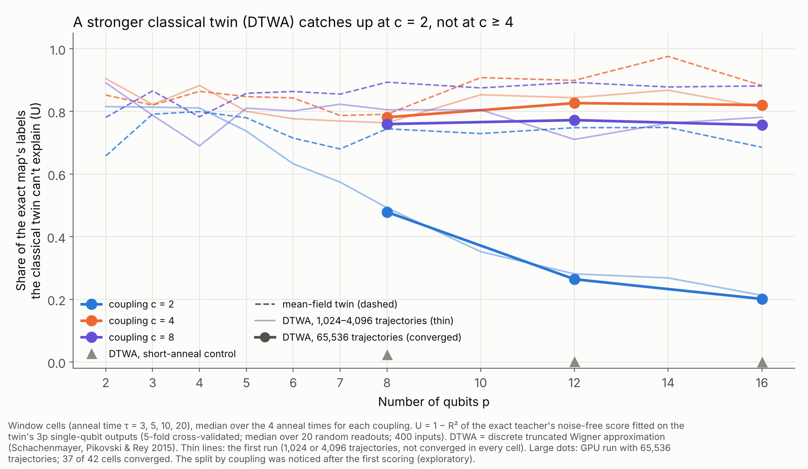
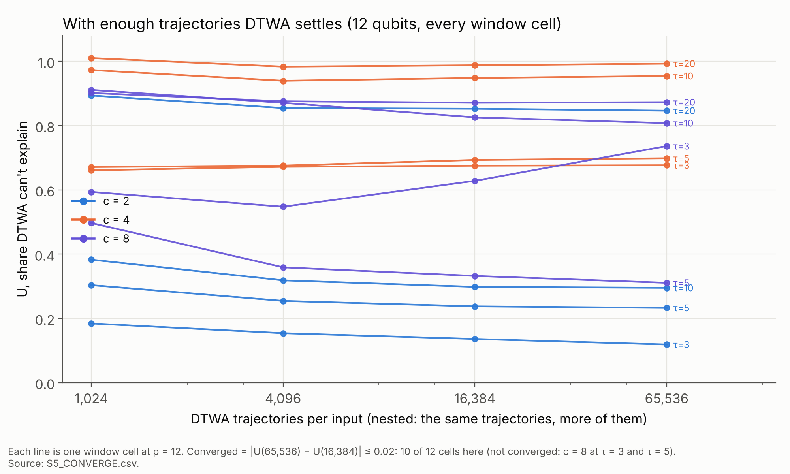

# S5 results: does a stronger classical twin copy the exact map?

*Runs of 2026-10-29/30. First run on CPU (ophlslcec08, M = 1,024, flagged cells rerun at 4,096),
then the convergence run on one H100 (Amendment 2, M up to 65,536). The plan, with predictions
D0–D3 fixed before any S5 code ran, is in `PLAN.md`; Amendments 1 and 2 (§9, §10) were written
after seeing results and before the runs they describe. Logs: `runs/s5.log` (first run),
`runs/s5_converge_score.log` (convergence). Tables: `runs/studies/s5/S5_MEASURES.csv`,
`S5_CONVERGE.csv`. Figures: `figures.py`, from those tables.*

## In plain language

**What we asked.** S2 showed that mean-field, the cheapest classical copy of our quantum map,
can't reproduce it in the window: it misses about 80% of the exact map's labels at every size up
to 16 qubits. But mean-field is the weakest classical copy there is, because it ignores all
correlations between qubits. A reviewer would ask whether a classical method that keeps those
correlations copies the map after all. If it did, the quantum part would be cheap to simulate.

**How.** We used the discrete truncated Wigner approximation (DTWA) [1]. It's the standard
classical method physicists use for spin dynamics beyond mean-field. It's known to work best for
all-to-all couplings like ours [3, 4], and it has been used to challenge a quantum-annealing
advantage claim [5].
- **The idea:** run many classical copies of the system from random starting points that mimic
  quantum uncertainty, then average them. The scatter between copies carries the correlations
  mean-field drops.
- **The measure:** as in S2, the share of the exact map's labels DTWA's outputs can't explain
  (U). Same inputs, same random readouts.
- **Your bet (D2):** at 12 qubits, DTWA still misses more than 30%.

**What we found.**

- **The quantum part survives DTWA, at strong coupling.** At 12 qubits, DTWA misses **72%** of
  the exact labels in the window (mean-field: 82%). D2 held.
- **But it depends on coupling strength, sharply.** At the weakest window coupling (c = 2), DTWA
  **catches up** as qubits are added: what it misses falls from about half at 8 qubits to a fifth
  at 16. At c = 4 and 8 it stays at about 80% at every size, with no trend.

- **This took care to get right.** DTWA's averages need many trajectories, and in the window
  they converge slowly. We went from 1,024 to 65,536 trajectories per input (on a GPU) until the
  numbers stopped moving: 37 of 42 cells converged. Even if the rest kept improving at the
  fastest plausible rate, the 12-qubit median couldn't fall below about 0.67.

- **How DTWA fails.** It reproduces the pair correlations almost perfectly (they correlate
  0.97–0.98 with the exact ones at 12–16 qubits). But at strong coupling and long anneals, its
  trajectories are chaotic and scatter so much that their averages barely change from one input
  to the next. The exact map keeps structured, input-dependent outputs. DTWA's don't.

**What it means.**
- **For c ≥ 4, the window's quantum part is robust:** neither mean-field nor a serious
  correlation-keeping classical method copies it, at any size we can simulate (up to 16 qubits),
  with no sign of catching up.
- **At c = 2, it isn't:** DTWA increasingly copies the exact map as qubits are added. The
  defensible claim is "the window at c ≥ 4", not "the window".
- **The coupling split was noticed after the first scoring, so it's exploratory.** It needs
  confirming on new cells, for example c = 3 and 6, before it's stated as a result.

**What to be careful about.**
- **Range:** up to 16 qubits. DTWA is a large-p method, and its accuracy usually improves with
  size, so the c ≥ 4 result describes this range, not the infinite-p limit.
- **Small p:** DTWA is *worse* than mean-field at 2–6 qubits (D0 and D1 failed there). That's a
  known limitation of the method with few spins, not a code error (checked; see Details).
- **One stronger twin:** the pair (cumulant) expansion and tensor networks weren't tried.

### References

1. Schachenmayer, J., Pikovski, A. & Rey, A. M. (2015). Many-body quantum spin dynamics with Monte Carlo trajectories on a discrete phase space. *Physical Review X* 5, 011022. [arXiv:1408.4441](https://arxiv.org/abs/1408.4441)
2. Polkovnikov, A. (2010). Phase space representation of quantum dynamics. *Annals of Physics* 325, 1790. [doi:10.1016/j.aop.2010.02.006](https://doi.org/10.1016/j.aop.2010.02.006)
3. Khasseh, R., Russomanno, A., Schmitt, M., Heyl, M. & Fazio, R. (2020). Discrete truncated Wigner approach to dynamical phase transitions in Ising models after a quantum quench. *Physical Review B* 102, 014303. [arXiv:2004.09812](https://arxiv.org/abs/2004.09812)
4. Kunimi, M., Nagao, K., Goto, S. & Danshita, I. (2021). Performance evaluation of the discrete truncated Wigner approximation for quench dynamics of quantum spin systems with long-range interactions. [arXiv:2008.13481](https://arxiv.org/abs/2008.13481)
5. Sels, D. (2026). Truncated Wigner dynamics of biclique quantum spin glasses. Preprint, not yet peer-reviewed. [arXiv:2606.20187](https://arxiv.org/abs/2606.20187)

---

## Details

### Checks

| | Prediction | Result | |
|---|---|---|---|
| D0 | Sanity: short-anneal control, U_DTWA ≤ U_MF at every p, and < 0.01 at p ≥ 8 | worse than mean-field at p = 3–6 (e.g. p = 4: 0.236 vs 0.041); 0.019 at p = 8; ≤ 0.0014 from p = 10 | **failed** (small p only) |
| D1 | DTWA beats mean-field in ≥ 9 of 12 window cells at every p | 0, 5, 8 of 12 at p = 2, 3, 4; 9–12 of 12 from p = 5 | **failed** (small p only) |
| D2 | Median window U_DTWA at p = 12 > 0.3 | **0.717** at M = 65,536 (mean-field 0.818); 2 of 12 cells not converged (≤ 3 allowed) | **held** |
| D3 | *Reported:* median exponent of U_DTWA over window cells (first run, p = 4–16) | 0.020 [−0.014, 0.051] | (no prediction) |

### Converged values (M = 65,536; p = 8 uses every one of the 4⁸ starting points, so it's exact)

U_DTWA, with mean-field's U in brackets:

| cell | p = 8 | 12 | 16 |
|---|---|---|---|
| c = 2, τ = 3 | 0.250 (0.520) | 0.119 (0.613) | **0.054** (0.477) |
| c = 2, τ = 5 | 0.475 (0.792) | 0.233 (0.708) | **0.120** (0.658) |
| c = 2, τ = 10 | 0.483 (0.697) | 0.295 (0.805) | 0.283 (0.856) |
| c = 2, τ = 20 | 0.783 (0.837) | 0.847 (0.788) | 0.672 (0.712) |
| c = 4, τ = 3 | 0.705 (0.729) | 0.677 (0.723) | 0.641 (0.723) |
| c = 4, τ = 5 | 0.709 (0.737) | 0.698 (0.795) | 0.788 (0.861) |
| c = 4, τ = 10 | 0.854 (0.845) | 0.954 (1.003) | 1.019 (1.022) |
| c = 4, τ = 20 | 0.922 (0.862) | 0.993 (1.030) | 0.853 (0.904) |
| c = 8, τ = 3 | 0.557 (0.804) | 0.736* (0.831) | 0.770* (0.829) |
| c = 8, τ = 5 | 0.650 (0.837) | 0.311* (0.854) | 0.692 (0.841) |
| c = 8, τ = 10 | 0.869 (0.949) | 0.808 (0.931) | 0.751* (0.954) |
| c = 8, τ = 20 | 0.993 (0.980) | 0.873 (0.933) | 0.761 (0.922) |
| **window median** | **0.707** (0.821) | **0.717** (0.818) | **0.721** (0.848) |
| short-anneal control | 0.023 (0.049) | 0.000 (0.002) | 0.000 (0.000) |
| weak-coupling control | 0.000 (0.002) | 0.000 (0.001) | 0.000 (0.001) |

\* not converged: |U(65,536) − U(16,384)| > 0.02 (also c = 8, τ = 3 at p = 8). U > 1 means the
out-of-fold fit is worse than predicting the mean: the twin's outputs carry no usable information.

**By coupling (median over τ):** c = 2: 0.479, 0.264, 0.201; c = 4: 0.781, 0.826, 0.820;
c = 8: 0.759, 0.772, 0.756 (p = 8, 12, 16). *Exploratory.*
- **At c = 2, DTWA catches up at τ = 3–10** but not at τ = 20 (0.67 at p = 16).

### Convergence in the number of trajectories

- **First run (CPU):** at M = 1,024 the noise check flagged many cells, mostly at c = 2. U at M/4
  exceeded U at M by up to 0.19. After the rerun at 4,096, 29 cells still differed by more than
  0.02, **in both directions**, so a simple bias correction (Amendment 1) wasn't reliable.
- **Convergence run (GPU, Amendment 2):** nested M = 1,024 / 4,096 / 16,384 / 65,536 from one set
  of trajectories, at p = 8, 12, 16. **37 of 42 cells converged.**
- **Signal-to-noise of DTWA's features** (spread of each feature over inputs ÷ its sampling
  variance; median feature) at M = 65,536:
  - controls: 660–11,700;
  - c = 2: 150–700;
  - **c ≥ 4 at τ ≥ 5: 5–170, most below 70.**

  At strong coupling and long anneals, DTWA's averages barely vary from input to input.
- **Bound for unconverged cells.** If remaining sampling noise only attenuates R² by the signal
  fraction (snr − 1)/snr, then U at M → ∞ is at least 1 − R²/(signal fraction). The window medians
  of that bound are 0.699, 0.674, 0.676 (p = 8, 12, 16); by coupling, c = 4: 0.78–0.82,
  c = 8: 0.69–0.75. D2 holds under the bound.

### Correlations

At p = 12–16 in the window (first run), DTWA's connected ZZ correlations correlate 0.97–0.98
with the exact ones, and its total pull on one qubit (C_coll) is close to the exact value
(2.37 vs 2.26 at p = 12). DTWA gets the correlations' size and pattern right. Where it fails is the
input dependence of the single-qubit outputs.

### Code checks

- **Mean-field limit:** one unit-vector trajectory equals `meanfield_local` to 10⁻¹³.
- **No coupling:** DTWA averaged over all starting points equals the exact map exactly.
- **Coupled case (added in Amendment 1):** fields + coupling with no driver, where DTWA's
  single-qubit values are exact. Matches to 10⁻¹⁰ at p = 2, 3, 4, 6. So D0/D1's small-p failures
  are the method, not the code.
- **GPU version:** float64, matches the NumPy version to 10⁻⁹. float32 was dropped: single
  trajectories drift ~0.03 after 1,600 steps (the dynamics are chaotic).

### Run time

- First run on CPU: 68 minutes (154 cells, 29 workers), plus the 50-cell rerun at 4,096 overnight
  (the 16-qubit, τ = 20 cells took 6.5 hours each).
- Convergence run: 60 minutes on one H100 (42 cells, up to 65,536 trajectories each).
